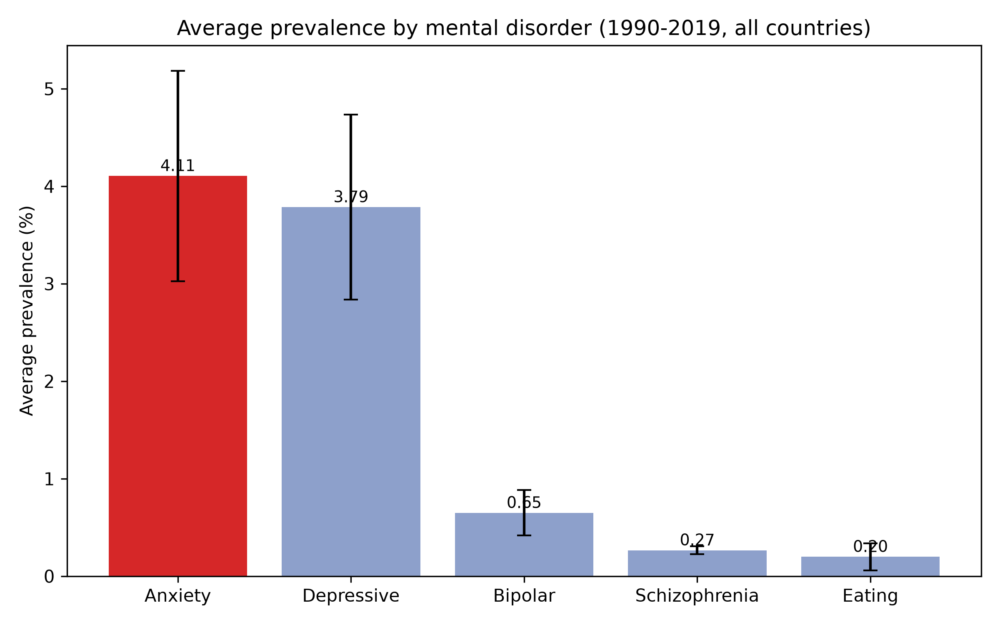
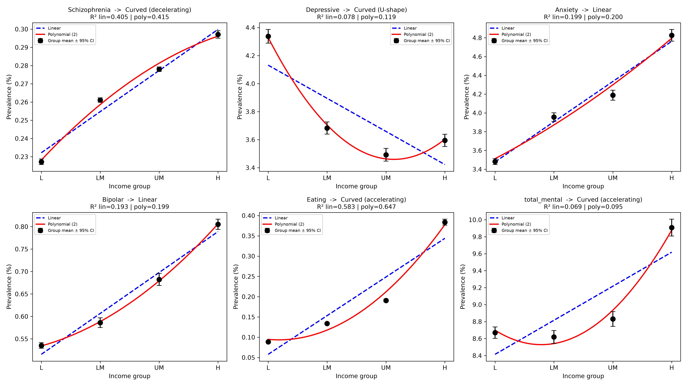
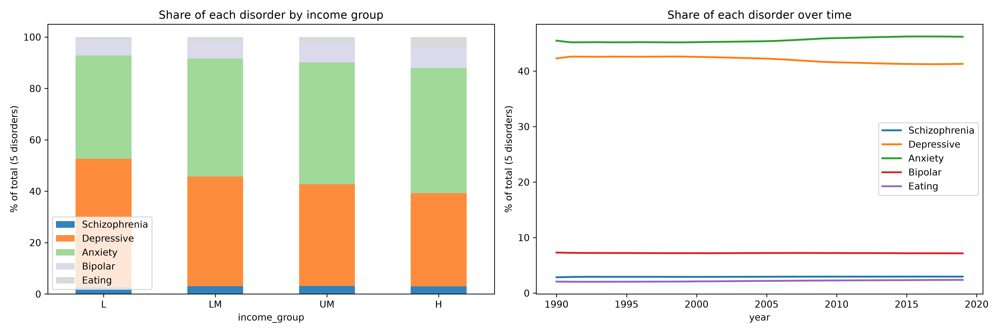
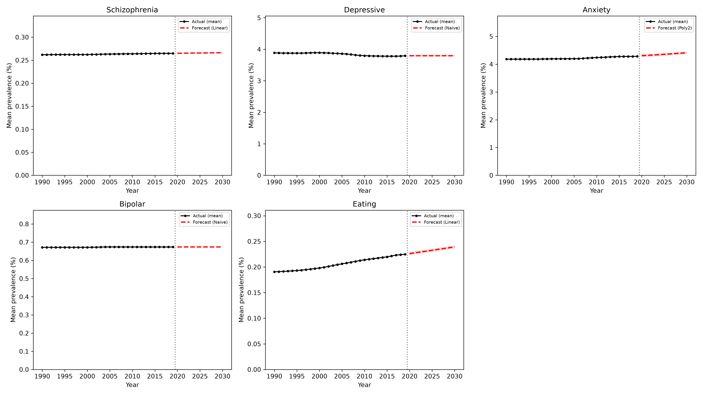

# Analysis and Comparison of Mental Illness Across Countries

วิเคราะห์และเปรียบเทียบอัตราการพบโรคทางจิต 5 ประเภท (โรคจิตเภท ซึมเศร้า วิตกกังวล ไบโพลาร์ และการกินผิดปกติ) ของ 201 ประเทศ ช่วงปี ค.ศ. 1990–2019 โดยเชื่อมกับระดับรายได้ของประเทศตามการจัดกลุ่มของธนาคารโลก (World Bank) เพื่อดูว่าโรคแต่ละประเภทสัมพันธ์กับรายได้ของประเทศอย่างไร และจะมีแนวโน้มอย่างไรถึงปี 2030

## คำถามการวิจัย

1. โรคทางจิตประเภทใดมีอัตราการพบสูงสุดโดยเฉลี่ย
2. ประเทศใดมีอัตราผู้ป่วยโรคทางจิตสูงที่สุด และประเภทของโรคทางจิตมีความสัมพันธ์กับรายได้ของประเทศหรือไม่ ถ้ามี สัมพันธ์แบบเส้นตรงหรือเส้นโค้ง
3. สัดส่วนผู้ป่วยโรคทางจิตแต่ละประเภทแตกต่างกันอย่างไร และจะมีแนวโน้มเป็นอย่างไรในอนาคต

## สรุปผลการวิเคราะห์

| คำถาม | คำตอบโดยย่อ |
| --- | --- |
| 1. โรคที่พบสูงสุด | **Anxiety (โรควิตกกังวล)** เฉลี่ย 4.106% ของประชากร รองลงมาคือ Depressive 3.785% และเป็นอันดับ 1 ครบทั้ง 30 ปี |
| 2. ประเทศที่สูงสุด | เมื่อรวม 5 โรค **Portugal** สูงสุด (14.25%) ตามด้วย New Zealand (13.47%) และ Palestine (13.39%) |
| 2. ความสัมพันธ์กับรายได้ | ทุกโรคสัมพันธ์กับระดับรายได้อย่างมีนัยสำคัญ (p < 0.001) Eating, Schizophrenia, Anxiety และ Bipolar สูงขึ้นตามรายได้ ส่วน **Depressive สวนทาง** คือสูงสุดในประเทศรายได้ต่ำ |
| 2. เส้นตรงหรือเส้นโค้ง | Anxiety และ Bipolar เป็นเส้นตรง, Schizophrenia เกือบเป็นเส้นตรง, Depressive เป็นรูปตัว U, Eating และผลรวมทุกโรคเป็นเส้นโค้งที่เร่งขึ้นในกลุ่มรายได้สูง |
| 3. สัดส่วนโรค | Anxiety (45.6%) และ Depressive (42.0%) รวมกันราว 88% ของผู้ป่วยทั้ง 5 โรค ประเทศรายได้ต่ำมีสัดส่วน Depressive สูงกว่า ประเทศรายได้สูงมีสัดส่วน Anxiety และ Eating สูงกว่า |
| 3. แนวโน้มถึงปี 2030 | อัตราโดยเฉลี่ยค่อนข้างคงที่ โดย Anxiety และ Eating มีแนวโน้มเพิ่มขึ้นเล็กน้อย |

รายละเอียดของแต่ละข้ออยู่ในหัวข้อ [ผลการวิเคราะห์](#ผลการวิเคราะห์) ด้านล่าง

## แหล่งข้อมูล

| ชุดข้อมูล | แหล่งที่มา | ใช้ทำอะไร |
| --- | --- | --- |
| Mental Health (ไฟล์ mental-illnesses-prevalence) | Kaggle: https://www.kaggle.com/datasets/imtkaggleteam/mental-health | อัตราการพบโรคทางจิต 5 ประเภท รายประเทศ รายปี 1990–2019 (ค่าประมาณแบบ age-standardized จาก IHME Global Burden of Disease) |
| World Bank Historical Income Classification (`OGHIST_2026_10_08.xlsx`) | World Bank: https://datahelpdesk.worldbank.org/knowledgebase/articles/906519 | กลุ่มรายได้ของแต่ละประเทศในแต่ละปี (Low / Lower-middle / Upper-middle / High income) |

## โครงสร้างโฟลเดอร์

```
Mental-Illness/
├── Code/
│   ├── Clean_data.ipynb                 # ทำความสะอาดข้อมูลทั้ง 2 ชุด และ merge
│   └── answer_research_questions.ipynb  # วิเคราะห์ตอบคำถามวิจัยทั้ง 3 ข้อ
├── Data/
│   ├── raw/
│   │   ├── Mental.csv                   # ข้อมูลสุขภาพจิตดิบ (ห้ามแก้ไขด้วยมือ)
│   │   └── OGHIST_2026_10_08.xlsx       # ข้อมูลกลุ่มรายได้ดิบจาก World Bank
│   └── processed/
│       ├── Mental_cleaned.csv           # ข้อมูลสุขภาพจิตที่คลีนแล้ว
│       ├── outlier_summary.csv          # สรุปค่าผิดปกติ (IQR) ของแต่ละโรค
│       ├── income_cleaned.csv           # ข้อมูลกลุ่มรายได้ที่คลีนแล้ว
│       └── mental_income_merged.csv     # ข้อมูลที่ใช้วิเคราะห์จริง
├── Results/
│   ├── tables/                          # ตารางผลลัพธ์ (.csv)
│   └── figures/                         # กราฟ (.png)
├── LICENSE
└── README.md
```

## ขั้นตอนการทำงาน

### 1. ทำความสะอาดข้อมูลสุขภาพจิต (`Clean_data.ipynb`)

- ไฟล์ดิบมี 6,420 แถว 8 คอลัมน์ ไม่มีแถวซ้ำ และไม่มีค่าติดลบหรือเกิน 100%
- คอลัมน์ `Code` ว่าง 270 แถว ตรวจแล้วเป็นแถวของกลุ่มรวม 9 กลุ่ม (เช่น Asia (IHME GBD), High-income countries) ไม่ใช่ข้อมูลเสีย จึงเติมเป็น `Unknown` แทนการลบ
- เปลี่ยนชื่อคอลัมน์โรคที่ยาวให้สั้นลง เช่น `Depressive disorders (share of population) - Sex: Both - Age: Age-standardized` → `Depressive_pct`
- สร้างคอลัมน์ `Entity_type` แยก **Country** (204 ประเทศ) ออกจาก **Region/Group** (10 กลุ่ม รวม World)
- ตรวจค่าผิดปกติด้วยกฎ 1.5 × IQR (เฉพาะระดับประเทศ) โดย **นับแต่ไม่ลบ** เพราะค่าที่สูงเป็นค่าจริงของบางประเทศ ผลอยู่ใน `outlier_summary.csv`

### 2. ทำความสะอาดข้อมูลรายได้ (`Clean_data.ipynb`)

- ใช้ชีต `Country Analytical History` เลือกเฉพาะปี 1990–2019 ให้ตรงกับข้อมูลสุขภาพจิต
- แปลงรหัส `L`, `LM`, `UM`, `H` เป็นชื่อกลุ่มรายได้เต็ม และแปลงค่า `..` เป็นค่าว่าง
- แปลงจากตารางแนวกว้าง (1 คอลัมน์ต่อปี) เป็นแนวยาว (1 แถวต่อประเทศต่อปี) ได้ 6,690 แถว จาก 223 ประเทศ
- มีค่าว่าง 402 แถว (6%) ซึ่งเป็นปีที่ประเทศนั้นยังไม่มีอยู่หรือยังไม่ถูกจัดกลุ่ม เช่น South Sudan, USSR (former)

### 3. รวมข้อมูล (merge)

- เก็บเฉพาะแถวระดับประเทศ แล้ว merge ด้วย `country_code` + `year`
- ตัด 252 แถวที่ไม่มีกลุ่มรายได้ออก (รวมถึง 3 พื้นที่ที่ไม่มีข้อมูลรายได้เลย คือ Cook Islands, Niue, Tokelau)
- ได้ข้อมูลสุดท้าย **5,868 แถว 201 ประเทศ** ไม่มีค่าว่าง ไม่มีคู่ (ประเทศ, ปี) ซ้ำ และมี 35 ประเทศที่มีข้อมูลไม่ครบ 30 ปี

### 4. วิเคราะห์ (`answer_research_questions.ipynb`)

| คำถาม | วิธีที่ใช้ |
| --- | --- |
| 1 | สถิติพรรณนา (mean, median, SD, min, max) และตรวจว่าโรคที่สูงสุดเป็นอันดับ 1 ทุกปีหรือไม่ |
| 2 | จัดอันดับ Top 10 ประเทศจากค่าเฉลี่ย 1990–2019, ทดสอบความสัมพันธ์กับรายได้ด้วย Spearman correlation และ Kruskal-Wallis (พร้อมค่า ε²), เทียบโมเดลเส้นตรงกับพหุนามกำลังสองด้วย OLS, AIC, F-test และ p-value แบบ cluster-robust ตามประเทศ |
| 3 | คำนวณสัดส่วนของแต่ละโรคเทียบกับผลรวม 5 โรค แยกตามกลุ่มรายได้และปี, ทดสอบ Anxiety กับ Depressive ด้วย Wilcoxon signed-rank test, พยากรณ์ถึงปี 2030 โดยเทียบ 4 โมเดล (Naive, Linear, Polynomial ดีกรี 2, Random Forest) |

## ผลการวิเคราะห์

### คำถามที่ 1: โรคที่มีอัตราการพบสูงสุดโดยเฉลี่ย

| อันดับ | โรค | ค่าเฉลี่ย (%) | ค่ามัธยฐาน (%) | SD |
| ---: | --- | ---: | ---: | ---: |
| 1 | Anxiety | 4.106 | 3.941 | 1.079 |
| 2 | Depressive | 3.785 | 3.682 | 0.949 |
| 3 | Bipolar | 0.649 | 0.582 | 0.233 |
| 4 | Schizophrenia | 0.265 | 0.272 | 0.040 |
| 5 | Eating | 0.198 | 0.148 | 0.140 |

Anxiety เป็นอันดับ 1 ครบทั้ง 30 ปี แสดงว่าผลคงเส้นคงวา Anxiety และ Depressive อยู่ในระดับใกล้กัน และสูงกว่าโรคอื่นประมาณ 6–20 เท่า



*แถบความคลาดเคลื่อนแสดงค่า SD ระหว่างประเทศ-ปี*

### คำถามที่ 2: ประเทศที่สูงสุด และความสัมพันธ์กับรายได้

**ประเทศอันดับ 1 ของแต่ละโรค (ค่าเฉลี่ย 1990–2019)**

| โรค | ประเทศ | ค่าเฉลี่ย (%) |
| --- | --- | ---: |
| Schizophrenia | United States | 0.449 |
| Depressive | Uganda | 7.143 |
| Anxiety | Portugal | 7.909 |
| Bipolar | New Zealand | 1.497 |
| Eating | Australia | 0.890 |
| รวม 5 โรค | Portugal | 14.251 |

**ความสัมพันธ์กับระดับรายได้** (กำหนดรหัสรายได้ 1 = Low ถึง 4 = High)

| โรค | Spearman ρ | ทิศทาง | รูปแบบ |
| --- | ---: | --- | --- |
| Eating | 0.84 | บวก | เส้นโค้งเร่งขึ้น (accelerating) |
| Schizophrenia | 0.66 | บวก | เกือบเป็นเส้นตรง |
| Anxiety | 0.45 | บวก | เส้นตรง |
| Bipolar | 0.43 | บวก | เส้นตรง |
| Depressive | −0.28 | ลบ | รูปตัว U (ลดลงแล้วเพิ่มขึ้นเล็กน้อยในกลุ่มรายได้สูง) |
| รวม 5 โรค | 0.24 | บวก | เส้นโค้งเร่งขึ้น |

ทุกโรคมี p < 0.001 ทั้งใน Spearman และ Kruskal-Wallis ยกเว้นผลรวม 5 โรคเมื่อดูเฉพาะปี 2019 ที่ไม่มีนัยสำคัญ (p = 0.069) ตารางสมการถดถอยทั้งหมดอยู่ใน `Results/tables/regression_equations.csv`



### คำถามที่ 3: สัดส่วนของแต่ละโรค และแนวโน้มในอนาคต

**สัดส่วนเทียบกับผลรวม 5 โรค (%)**

| กลุ่ม | Anxiety | Depressive | Bipolar | Schizophrenia | Eating |
| --- | ---: | ---: | ---: | ---: | ---: |
| ทุกประเทศ | 45.61 | 42.04 | 7.21 | 2.95 | 2.20 |
| Low income | 40.16 | 50.03 | 6.17 | 2.62 | 1.02 |
| Lower-middle income | 45.89 | 42.73 | 6.80 | 3.03 | 1.55 |
| Upper-middle income | 47.42 | 39.54 | 7.73 | 3.15 | 2.16 |
| High income | 48.72 | 36.28 | 8.13 | 3.00 | 3.87 |

Anxiety กับ Depressive ต่างกันอย่างมีนัยสำคัญ (Wilcoxon p < 0.001) เมื่อเทียบกับปี 1990 อัตรา Eating เพิ่มขึ้นสัมพัทธ์ราว 18% มากที่สุดในทุกโรค แต่ระดับจริงยังต่ำ (ประมาณ 0.2%) Anxiety เพิ่มราว 2.5% Depressive ลดลงราว 2.5% ส่วน Bipolar และ Schizophrenia แทบไม่เปลี่ยน



**การพยากรณ์ถึงปี 2030**

ใช้ค่าเฉลี่ยรายปีของ 166 ประเทศที่มีข้อมูลครบ 30 ปี ทดสอบย้อนหลัง (backtest) โดยฝึกด้วยปี 1990–2012 และทดสอบกับปี 2013–2019 แล้วเลือกโมเดลที่ RMSE ต่ำสุดของแต่ละโรค

| โรค | โมเดลที่เลือก | ค่าพยากรณ์ปี 2030 (%) |
| --- | --- | ---: |
| Anxiety | Polynomial ดีกรี 2 | 4.412 |
| Depressive | Naive (ค่าปีล่าสุด) | 3.793 |
| Bipolar | Naive (ค่าปีล่าสุด) | 0.673 |
| Schizophrenia | Linear | 0.266 |
| Eating | Linear | 0.239 |

สำหรับ Bipolar นั้น Naive กับ Random Forest ให้ RMSE ใกล้เคียงกัน จึงเลือก Naive เพราะเรียบง่ายกว่า และ Random Forest พยากรณ์นอกช่วงข้อมูลที่ฝึกไม่ได้อยู่แล้ว



## ข้อจำกัด

- ค่าเฉลี่ยทุกค่าให้น้ำหนักทุกประเทศเท่ากัน ไม่ได้ถ่วงน้ำหนักตามจำนวนประชากร
- เป็นความสัมพันธ์ระดับประเทศ จึงบอกไม่ได้ว่ารายได้เป็น *สาเหตุ* ของโรค และไม่สามารถสรุปไปถึงระดับบุคคลได้
- ข้อมูลโรคเป็นค่าประมาณจากแบบจำลองของ IHME ไม่ใช่การนับผู้ป่วยโดยตรง และสิ้นสุดที่ปี 2019 จึงไม่ครอบคลุมผลกระทบของ COVID-19
- การพยากรณ์ใช้ข้อมูลเพียง 30 จุด (รายปี) ช่วงที่แสดงในกราฟคำนวณจาก ±1.96 × RMSE ของ backtest เป็นเพียงช่วงโดยประมาณ ไม่ใช่ช่วงความเชื่อมั่นทางสถิติ

## พจนานุกรมข้อมูล (Data Dictionary)

### `Data/processed/mental_income_merged.csv` (ไฟล์ที่ใช้วิเคราะห์)

5,868 แถว × 10 คอลัมน์

| คอลัมน์ | ชนิดข้อมูล | คำอธิบาย |
| --- | --- | --- |
| `country_name_mental` | ข้อความ | ชื่อประเทศ (จากข้อมูลสุขภาพจิต) |
| `country_code` | ข้อความ | รหัสประเทศ ISO 3 ตัวอักษร |
| `Entity_type` | ข้อความ | ประเภทพื้นที่ (ในไฟล์นี้เป็น `Country` ทั้งหมด) |
| `year` | ตัวเลข | ปี ค.ศ. (1990–2019) |
| `Schizophrenia` | ตัวเลข | อัตราผู้ป่วยโรคจิตเภท (% ของประชากร) |
| `Depressive` | ตัวเลข | อัตราผู้ป่วยโรคซึมเศร้า (% ของประชากร) |
| `Anxiety` | ตัวเลข | อัตราผู้ป่วยโรควิตกกังวล (% ของประชากร) |
| `Bipolar` | ตัวเลข | อัตราผู้ป่วยโรคไบโพลาร์ (% ของประชากร) |
| `Eating` | ตัวเลข | อัตราผู้มีภาวะการกินผิดปกติ (% ของประชากร) |
| `income_group` | ข้อความ | กลุ่มรายได้ในปีนั้น: `Low income`, `Lower-middle income`, `Upper-middle income`, `High income` |

### `Data/processed/Mental_cleaned.csv`

6,420 แถว × 9 คอลัมน์ (รวมทั้งประเทศและกลุ่มภูมิภาค)

| คอลัมน์ | ชื่อคอลัมน์เดิม | ชนิดข้อมูล | คำอธิบาย | ค่าว่างในไฟล์ดิบ |
| --- | --- | --- | --- | ---: |
| `Entity` | Entity | ข้อความ | ชื่อประเทศ หรือชื่อกลุ่มภูมิภาค/ระดับโลก | 0 |
| `Code` | Code | ข้อความ | รหัสประเทศ ISO 3 ตัวอักษร (กลุ่มรวมเป็น `Unknown`) | 270 |
| `Entity_type` | (สร้างขึ้นใหม่) | ข้อความ | `Country` หรือ `Region/Group` | – |
| `Year` | Year | ตัวเลข | ปี ค.ศ. (1990–2019) | 0 |
| `Schizophrenia_pct` | Schizophrenia disorders (share of population) | ตัวเลข | อัตราผู้ป่วยโรคจิตเภท (%) | 0 |
| `Depressive_pct` | Depressive disorders (share of population) | ตัวเลข | อัตราผู้ป่วยโรคซึมเศร้า (%) | 0 |
| `Anxiety_pct` | Anxiety disorders (share of population) | ตัวเลข | อัตราผู้ป่วยโรควิตกกังวล (%) | 0 |
| `Bipolar_pct` | Bipolar disorders (share of population) | ตัวเลข | อัตราผู้ป่วยโรคไบโพลาร์ (%) | 0 |
| `Eating_pct` | Eating disorders (share of population) | ตัวเลข | อัตราผู้มีภาวะการกินผิดปกติ (%) | 0 |

### `Data/processed/income_cleaned.csv`

6,690 แถว × 4 คอลัมน์

| คอลัมน์ | ชนิดข้อมูล | คำอธิบาย |
| --- | --- | --- |
| `country_code` | ข้อความ | รหัสประเทศ ISO 3 ตัวอักษร |
| `country_name` | ข้อความ | ชื่อประเทศตาม World Bank |
| `year` | ตัวเลข | ปี ค.ศ. (1990–2019) |
| `income_group` | ข้อความ | กลุ่มรายได้ (ว่าง 402 แถว สำหรับปีที่ไม่มีการจัดกลุ่ม) |

## วิธีรันซ้ำ

1. ติดตั้ง Python 3 และไลบรารีที่ใช้

   ```bash
   pip install pandas numpy matplotlib scipy scikit-learn openpyxl jupyter
   ```

2. วางไฟล์ดิบทั้ง 2 ไฟล์ไว้ใน `Data/raw/`
3. แก้ตัวแปร `BASE` ในแต่ละ notebook ให้ชี้ไปที่โฟลเดอร์ `Data` ในเครื่องของคุณ
4. รัน `Code/Clean_data.ipynb` เพื่อสร้างไฟล์ใน `Data/processed/`
5. รัน `Code/answer_research_questions.ipynb` ผลลัพธ์จะถูกบันทึกลง `Results/tables/` และ `Results/figures/`

## License

โค้ดในโปรเจกต์นี้เผยแพร่ภายใต้ [MIT License](LICENSE) ส่วนข้อมูลเป็นไปตามเงื่อนไขของแหล่งข้อมูลต้นทาง (Kaggle และ World Bank)

